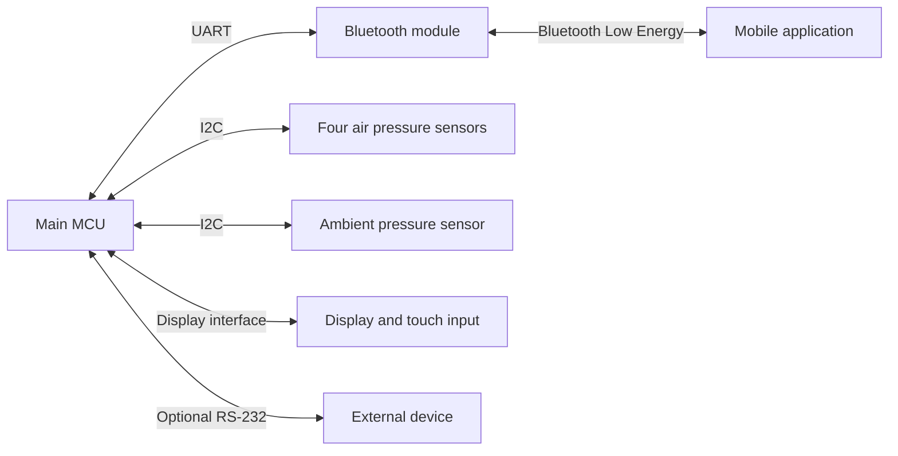
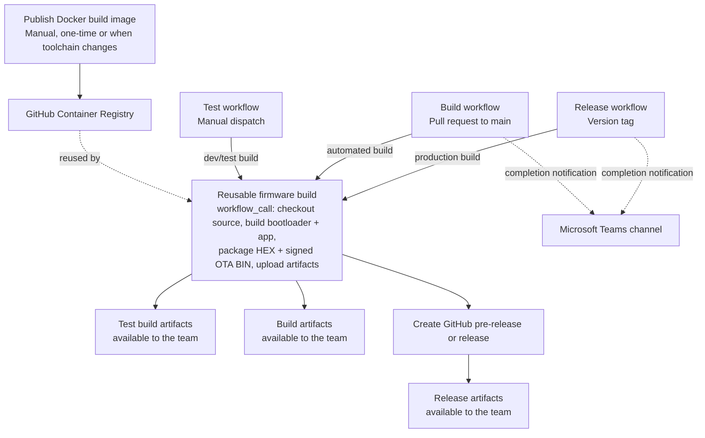
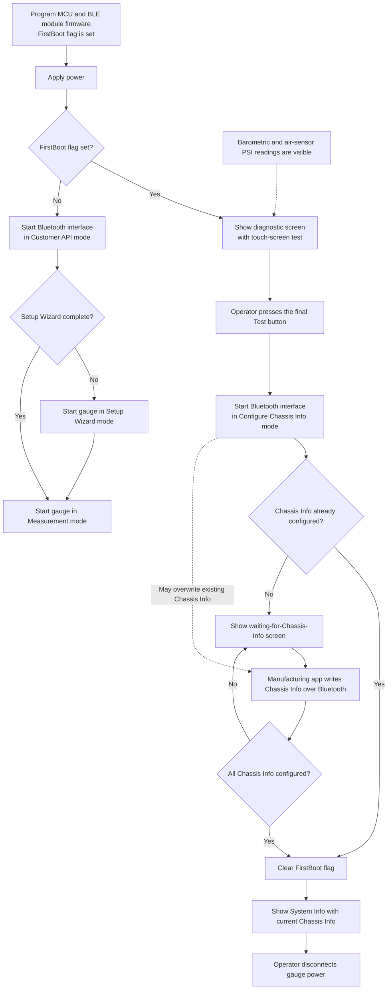

# Shared Operating Model

Embedded gauge products commonly combine a host MCU, peripheral sensors, a display, a BLE module, and a mobile application. The project comparison on the [documentation home page](../index.md) identifies which components and functions apply to each product.

## Device architecture

The following diagram shows a typical gauge device. The main MCU reads the pressure sensors, controls the display, and exchanges data with the Bluetooth module. The Bluetooth module relays supported sensor information to the mobile application.

## Typical runtime flow

1. Power is applied and the platform startup code runs.
2. If a bootloader is present, it checks for its supported update or recovery conditions and transfers control to the application.
3. The application initializes the required peripherals and product services.
4. The host communicates with its BLE module using the interface defined for that project.
5. A mobile application connects through the supported BLE services and displays the information exposed by the firmware.

## Firmware distribution flow

Firmware is built for a specific product and version. The release process validates the package and publishes it to the approved distribution channel. A product may support factory programming, an in-field update, a recovery flow, or a subset of these options.

### RW202 build and release pipeline

| Workflow               | Trigger                                                                                     | Project-specific behavior                                                                                            |
| ---------------------- | ------------------------------------------------------------------------------------------- | -------------------------------------------------------------------------------------------------------------------- |
| `docker-publish.yml` | Manual dispatch                                                                             | Builds and publishes the firmware build image to GitHub Container Registry.                                          |
| `build_fw.yml`       | Called by another workflow                                                                  | Checks out source and private submodules, builds bootloader and application, packages images, and uploads artifacts. |
| `test.yml`           | Manual dispatch                                                                             | Calls the reusable workflow with the `dev` configuration.                                                          |
| `build.yml`          | Push to `master` or manual dispatch                                                       | Calls the reusable workflow with the `production` configuration.                                                   |
| `release.yml`        | Push a `v*` tag Pre-release: **v**xx.yy-**RC**zz Release: **v**xx.yy.zz | Builds production firmware and publishes a GitHub **pre-release** or stable **release** according to the tag.      |

The build produces a combined manufacturing Intel HEX image and a signed OTA binary. Build, test, and release workflows send completion notifications with run and artifact links to the configured Microsoft Teams channel.

The PR-to-`main` path shows the requested workflow design. In the current checked-in configuration, `build.yml` runs on pushes to `master` and manual dispatch; it does not yet declare a pull-request trigger for `main`.

> **OTA rollout note:** OTA development began in 2026 and support is being introduced progressively. Not every product or firmware version supports every OTA step. Confirm compatibility for the exact device and firmware version before relying on an OTA update path.

Do not assume that bootloader behavior, memory layout, BLE services, or update transport is identical across projects. Refer to the central project overview and the shared topic guides before reusing a procedure.

## RW202 manufacturing process

This simplified flow is based on `Documentation/MfgProcessInteraction/202GaugeMfgProcessInteraction.drawio` (revision 1.2). It shows the first-boot path for factory programming and Chassis Info provisioning, followed by the normal customer startup path.

The manufacturing application can overwrite existing Chassis Info while the gauge is in the configuration mode. Product setup details and manufacturing tool instructions should follow the approved product-specific procedure.
