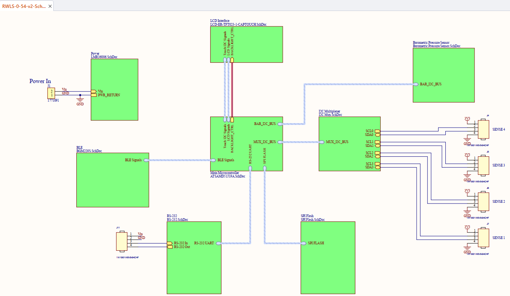

# 202 Dash Gauge Hardware

## Identification

| Item | 202 Dash Gauge |
| --- | --- |
| Hardware version | 54 |
| Main MCU | ATSAMD51J19A |
| BLE module | BGM220S |
| User interface | Color display with touch input |
| Pressure sensing | Four air-pressure sensors plus a barometric sensor |

The product-level view below is based on the available 202 block diagram. Confirm exact component revisions and signal names against the released schematic and BOM.

*Figure: 202 Dash Gauge schematic block diagram.*

## Main connections

- The ATSAMD51J19A is the main controller for sensing, application logic, and display control.
- The BGM220S provides BLE connectivity. The MCU-to-module application link is UART; confirm pin assignment and serial settings in the detailed schematic and firmware configuration.
- Four air-pressure sensors connect through an I²C multiplexer. The firmware identifies these as the four pressure-sensor inputs.
- A separate barometric pressure sensor connects on the barometric I²C bus.
- The color display and touch input connect to the MCU through the display and touch signals shown in the block diagram.
- An RS-232 interface is shown for external serial equipment. Its use depends on the board configuration and enabled firmware feature.
- External serial flash is shown for nonvolatile storage. Confirm the exact part and SPI/QSPI mode against the released schematic and driver configuration.
- Power input and regulation are shown in the block diagram; detailed power limits belong in the electrical design documentation.

## Firmware-facing notes

Firmware currently contains drivers for four MS5837 pressure sensors and an MS5637 barometric sensor, with I²C mux channel selection for the pressure sensors. The mux header defines PCA9545A write/read addresses and eight selectable channel identifiers; the 202 sensing path uses four channels. Consult the firmware pages for bus handling and sensor-data processing.

## Revision-specific records

Add the approved schematic revision, BOM revision, display part number, touch-controller part number, external flash part number, connector pinouts, and programming procedure when those controlled design records are available. Do not infer exact pin numbers from this functional block diagram.
