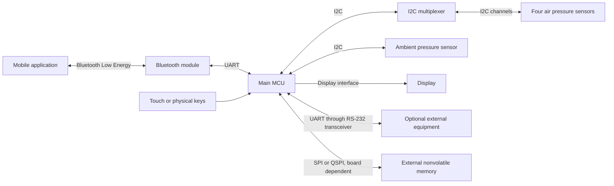

# Hardware Architecture

This page describes the shared device architecture. Product-specific parts and differences are listed in [201 Gauge](201-gauge.md) and [202 Dash Gauge](202-dash-gauge.md). Use the approved schematic and BOM for exact pin assignments, electrical limits, and board revisions.

## System overview

The main MCU reads pressure sensors, runs the gauge application, and controls the display. A separate Bluetooth Low Energy (BLE) module communicates with the MCU over UART and provides the wireless link to the mobile application. The MCU may also communicate with external equipment over an RS-232 interface.

The drawing shows the functional relationships. It does not define connector pinouts, voltage levels, bus rates, or exact peripheral instances.

## MCU connections

| Subsystem | MCU connection | Purpose | Design notes |
| --- | --- | --- | --- |
| BLE module | UART | Exchanges commands and data with the BLE module; the module provides the mobile link. | Document baud rate, flow control, framing, and UART instance per board revision. |
| Four air pressure sensors | I²C through a multiplexer | Reads separate pressure sensors that may share the same I²C address. | Select one mux channel before addressing its sensor. The 202 implementation uses four channels. |
| Ambient pressure sensor | I²C | Reads barometric pressure for environmental compensation and related calculations. | The 202 schematic shows a dedicated barometric I²C bus. |
| Display | Board-specific display interface | Presents measurements and device status. | Interface varies by product; consult the product page and schematic. |
| User input | Touch interface or GPIO-connected keys | Receives user selections and setup actions. | 202 uses touch input; 201 uses mechanical buttons. |
| External equipment | UART plus an RS-232 transceiver, when fitted | Exchanges serial data with compatible equipment. | RS-232 electrical signaling requires a transceiver; MCU UART pins are logic-level signals. |
| External memory | SPI/QSPI, board dependent | Stores data such as calibration or update images where implemented. | Verify memory part, bus mode, and address map for each product. |

## I²C pressure-sensor topology

Each sensor is addressed by the MCU using its I²C controller. The mux connects the shared upstream bus to one downstream channel at a time, allowing multiple sensors with the same address to coexist. The ambient pressure sensor is a separate device; its bus relationship must follow the product schematic.

For the 202 implementation, firmware defines four air-pressure sensors and selects mux channels while probing and sampling them. It also initializes a separate barometric sensor. See [202 Dash Gauge](202-dash-gauge.md) and [I²C and I²C Multiplexer](../3.firmware/2.peripherals.md).

## BLE and mobile data path

The MCU and BLE module form separate processing and radio responsibilities. The MCU obtains and processes sensor data, then exchanges application data with the BLE module over UART. The module exposes the Bluetooth connection used by the mobile application to view sensor information and perform supported device functions. BLE services, characteristic definitions, and framing are firmware-version specific; see [Bluetooth communication](../3.firmware/4.bluetooth-communication.md).

## RS-232 connection

Where fitted and enabled, the MCU uses a UART connected through an RS-232 transceiver to communicate with external equipment. The interface is optional and is controlled by the product hardware and firmware configuration. See [RS-232 communication](../3.firmware/2.peripherals.md).

## Product-specific hardware

- [201 Gauge](201-gauge.md): hardware version 52, BGM220P BLE module, seven-segment display, and mechanical buttons.
- [202 Dash Gauge](202-dash-gauge.md): hardware version 54, BGM220S BLE module, color display, and touch input.

## Design records to maintain

For every board revision, keep the MCU and module part numbers, schematic and BOM revisions, connector pinout, signal direction, voltage domain, programming/debug method, and supported firmware version together. Treat changes to sensor count, mux topology, display interface, BLE module, storage device, or serial interface as product compatibility changes.
