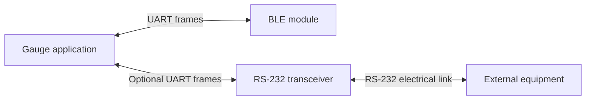

# Firmware Peripherals

This section describes the firmware-facing peripheral interfaces used by the gauge products. Exact pins, peripheral instances, timing, and enabled features are defined by each board configuration.

| Interface | Typical role                                    | Details                                            |
| --------- | ----------------------------------------------- | -------------------------------------------------- |
| UART      | MCU-to-BLE module and optional serial equipment | [UART](2.peripherals.md)                                     |
| I²C      | Pressure sensors, ambient sensor, and I²C mux  | [I²C and I²C Multiplexer](2.peripherals.md) |
| SPI/QSPI  | External serial flash where fitted              | [SPI and QSPI](2.peripherals.md)                     |

## Shared implementation guidance

Keep bus ownership explicit, check transfer completion and error status, and avoid accessing a shared bus concurrently without the project’s synchronization mechanism. Peripheral configuration and supported devices can differ between product lines; always trace behavior to the target configuration and schematic.

# RS-232 Communication

Some device configurations provide an optional serial connection to external equipment. Firmware uses a UART at MCU logic levels and a transceiver converts those signals to RS-232 electrical levels.

The 202 source feature header defines `FEATURE_USE_RS232_INTERFACE` as disabled in the inspected configuration. Therefore, the interface should be considered optional and configuration-dependent.

For each enabled product, document the connector and pinout, transceiver, baud rate, parity, stop bits, flow control, protocol specification, message units, timeouts, and error behavior. Keep the external protocol independent of the MCU-to-BLE UART protocol.

# UART

## Uses

The MCU UART is used for the host link to the BLE module. Some board configurations can also route a UART through an RS-232 transceiver to external equipment. These links have separate protocol and configuration requirements even when they use the same MCU peripheral family.

## Data path

Document the UART instance, TX/RX pins, baud rate, parity, stop bits, flow control, buffering, framing, and timeout behavior for each board. Do not connect MCU logic-level UART signals directly to an RS-232 line; the transceiver performs the required electrical conversion.

## Reliability

Define how framing errors, overrun, disconnects, and partial frames are handled. Keep BLE-module framing separate from any external-device protocol. Add protocol-specific details to [Bluetooth communication](4.bluetooth-communication.md) and [RS-232 communication](2.peripherals.md).

# SPI and QSPI

## Current use

The 202 block diagram includes external serial flash, and application source references QSPI flash for calibration data and OTA image handling. The block diagram labels the memory as SPI flash; therefore, confirm the exact MCU peripheral mode, flash part, wiring, and memory map against the released schematic and board configuration before using this page for low-level implementation work.

## Documentation requirements

For each supported board, record the flash manufacturer and part number, bus mode, clock limits, chip-select behavior, address width, erase size, page/program size, protection settings, and any DMA/cache constraints. Keep the flash driver abstraction separate from application data formats.

Related pages: [External Flash](6.ota-support.md), [Memory Layout](6.ota-support.md), and [OTA Support](6.ota-support.md).

# I²C and I²C Multiplexer

## Bus roles

The 202 firmware reads four MS5837 air-pressure sensors and a separate MS5637 barometric sensor. The four pressure sensors are selected through an I²C multiplexer because they share the pressure-sensor bus topology; the barometric sensor is initialized and checked separately. Other products may use a different sensor set or bus arrangement.

## Multiplexer operation

The firmware exposes `I2CMux_selectChannel()` and PCA9545A address constants in its I²C mux interface. The channel enum contains channels 0 through 7. The 202 pressure-sensor code selects mux channels while probing and sampling the four sensors. The block diagram maps the four sensor branches to mux channels 0–3.

Typical access sequence:

1. Acquire the bus lock if the bus is shared by concurrent tasks.
2. Select the mux channel associated with the target sensor.
3. Perform the sensor transaction and check its result.
4. Release the bus lock on every success or error path.

## Sensor handling

The pressure-sensor implementation checks connectivity, resets/converts/reads sensor data, and handles transfer or CRC status through the sensor drivers. Preserve per-sensor identity when storing results. A mux-selection or I²C failure should not be represented as a valid pressure reading.

## Board-specific details to record

Record bus speed, MCU controller instance, pull-up voltage, mux address configuration, channel-to-sensor mapping, sensor addresses, and recovery behavior for a stuck bus in the product design documentation.
