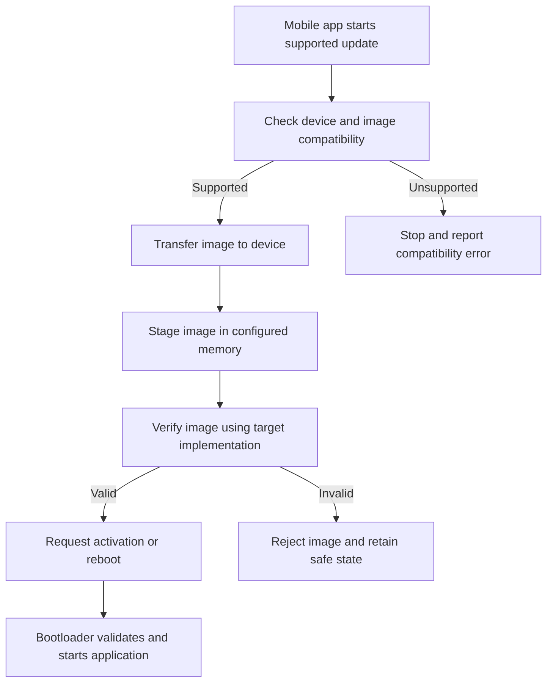

# OTA Support

OTA support is being introduced progressively from 2026. Availability depends on product, bootloader/application versions, and mobile-app support. Check the release notes and compatibility information for the target device before planning an update.

## Update components

The bootloader is responsible for startup validation, application handoff, and the update/recovery behavior implemented for that target. The application and BLE module are distinct firmware components; an application OTA path must not be assumed to update the BLE module.

The 202 application source contains an image-upload path using an SMP-style frame and QSPI write helpers. This source alone does not establish the full production activation, validation, rollback, or recovery behavior. Document those guarantees from the corresponding bootloader and mobile-app implementation.

## Related details

- [Memory Layout](6.ota-support.md)
- [External Flash](6.ota-support.md)
- [Update and Recovery](6.ota-support.md)

For each released combination, document image format, target hardware, version compatibility, transport, integrity/authenticity checks, activation rules, power-loss behavior, and recovery procedure.

# Firmware Memory Layout

Memory boundaries are bootloader- and hardware-version-specific. Use the linker scripts, bootloader configuration, and released build artifacts as the source of truth; do not copy addresses between products.

## Required map

Maintain a table for each target showing:

| Region                 | Start/end address                | Owner           | Erase/write constraints                                                                      |
| ---------------------- | -------------------------------- | --------------- | -------------------------------------------------------------------------------------------- |
| Bootloader             | From target linker/configuration | Bootloader      | Preserve during application update unless an explicitly supported bootloader update is used. |
| Active application     | From target linker/configuration | Application     | Must match the bootloader handoff and vector expectations.                                   |
| Staging/update image   | From target configuration        | OTA/update path | Must fit the largest supported image and meet flash erase/program rules.                     |
| Persistent device data | From target configuration        | Application     | Define schema, migration, and reset behavior.                                                |

The combined factory image and the OTA application image can have different contents and address assumptions. See [Build and Release](1.firmware.md) and [Update and Recovery](6.ota-support.md).

# Update and Recovery

## Update flow

This is a conceptual workflow. Exact validation, activation, rollback, and status reporting must be documented for each released implementation; the diagram does not imply that every step is currently enabled on every product.

## Recovery information to maintain

Document recovery behavior for interrupted transfer, power loss during flash operations, invalid image, failed application startup, and an unreachable BLE link. Include the required programming tool and factory image for restoring a device. Never assume rollback exists unless the target bootloader implements and verifies it.

OTA functionality is being introduced from 2026 and will expand across product versions over time. Check the specific release notes before performing an update.

# External Flash

External flash may hold calibration or other persistent data and can serve as OTA staging storage on supported targets. Actual use and capacity are product-specific.

## Design and firmware requirements

- Identify the exact flash part, capacity, interface mode, and board revision.
- Publish a memory map with reserved regions, offsets, erase blocks, and page sizes.
- Define data format, versioning, integrity checks, and migration behavior for persistent records.
- Prevent concurrent operations from corrupting calibration or an in-progress update.
- Define behavior for interrupted erase/program operations and failed verification.

The 202 source references QSPI for calibration data and OTA upload writes. Verify the part and layout from the released board and firmware configuration before servicing or provisioning devices.
